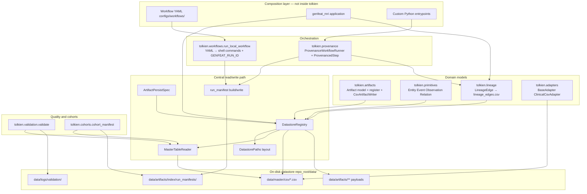
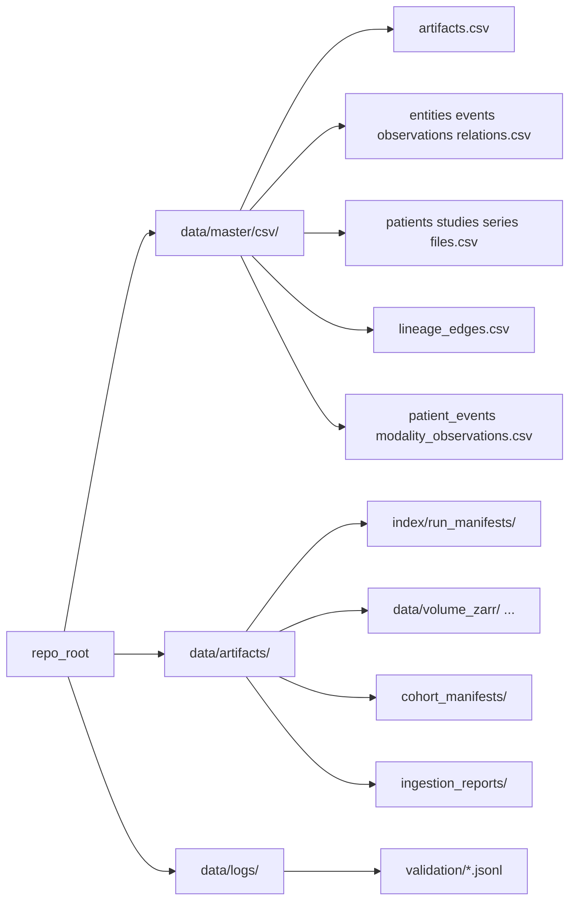
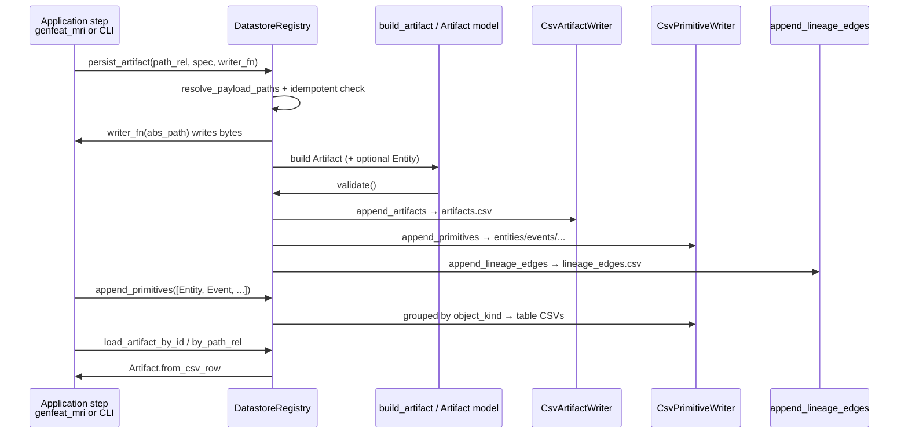
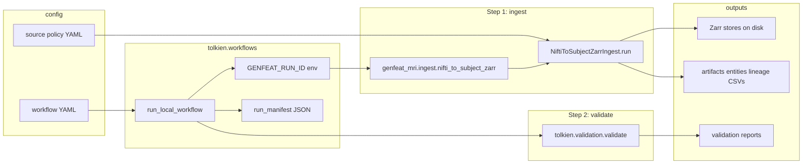
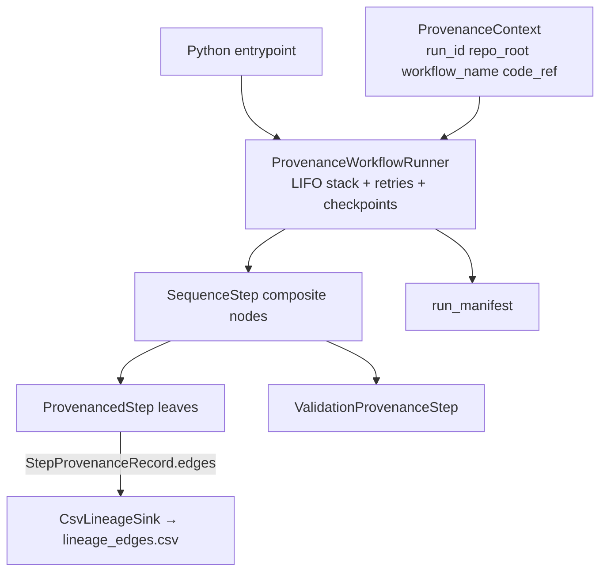
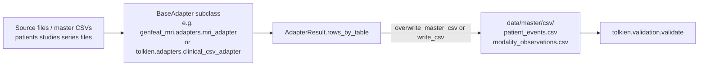
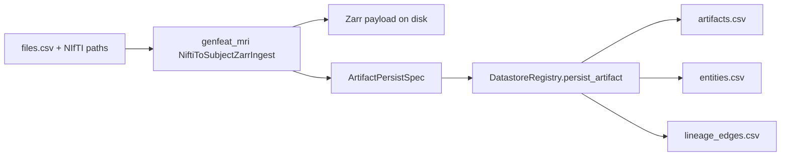
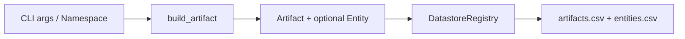
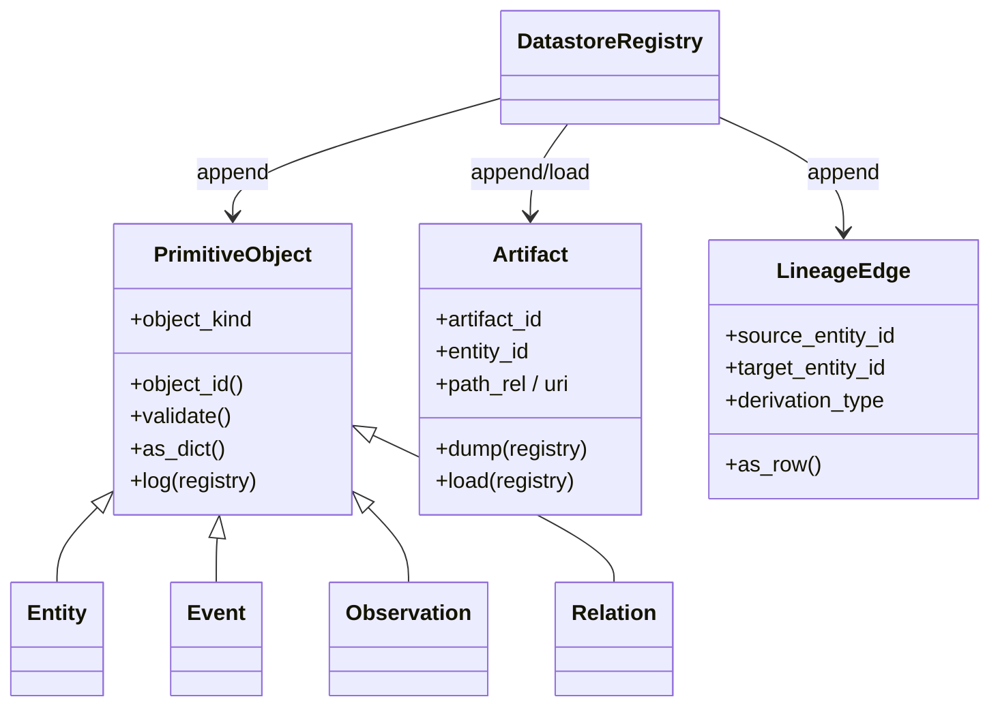
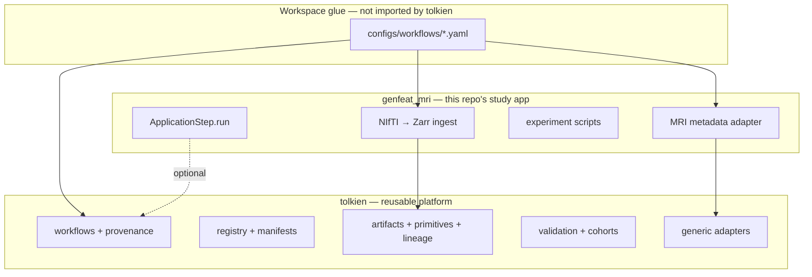

# Tolkien architecture and application flows

**Tolkien** (`tolkien/`) is a domain-agnostic, local-first library for reproducible data workflows. It owns orchestration, registries, validation, lineage, and cohort helpers. Study-specific logic (MRI ingest, adapters, experiments) lives in **`genfeat_mri`** and is composed via workflow YAML or Python — Tolkien never imports the app.

See also:

- [Platform vs application](../platform-vs-app.md) — boundary rules and install layout
- [Demo: ingestion workflow](../demo-ingestion-workflow.md) — end-to-end NIfTI → Zarr walkthrough with sequence diagrams
- [Orchestrating multimodal experiments](../orchestrating-multimodal-experiments-with-tolkien.md) — experiment composition patterns

---

## 1. Package layers



---

## 2. On-disk layout

Tolkien writes under a canonical filesystem layout derived from `DatastorePaths`:



**`DatastoreRegistry`** is the single entry point for appends to master CSVs, lineage, and run manifests. Callers should prefer it over calling CSV writers directly.

**`MasterTableReader`** (exposed as `registry.reader`) is the single read gateway for master CSV mirrors. Application and platform code should use `reader.read_table(stem)` or `reader.read_active_table(stem)` instead of opening `data/master/csv/*.csv` directly. Every read invokes `DatastorePermissions.assert_can_read` (stubbed no-op today; reserved for future allowlists and audit logging).

---

## 3. Core registry flow

Most catalog writes go through **`DatastoreRegistry`**:



Convenience methods on domain models delegate to the same registry:

- **`Artifact.dump(registry)`** — append artifact row
- **`PrimitiveObject.log(registry)`** — append primitive row(s)
- **`Artifact.load(registry, ...)`** — read back from `artifacts.csv`

---

## 4. Two orchestration modes

Tolkien supports two ways to run pipelines. Use one mode per workflow; do not mix edges between them.

| Mode | Entry | Steps are | Lineage | Manifest |
|------|--------|-----------|---------|----------|
| **YAML / shell** | `tolkien-run-workflow` | Subprocess commands | Written inside each step (e.g. `--lineage`) | `run_local_workflow` |
| **In-process** | Custom Python | `ProvenancedStep` / `WorkflowNode` | Centralized via `ProvenanceSink` after each leaf | `ProvenanceWorkflowRunner` |

### 4a. YAML workflow (default in this repo)

Example: `configs/workflows/nifti_to_subject_zarr.yaml`



Run:

```bash
tolkien-run-workflow configs/workflows/nifti_to_subject_zarr.yaml --repo-root .
# or
python -m tolkien.workflows.run_local_workflow configs/workflows/nifti_to_subject_zarr.yaml --repo-root .
```

### 4b. In-process provenance runner

For Python-native pipelines without a subprocess per step:



Each leaf returns a **`StepProvenanceRecord`**: outcome, used/generated entity refs, and optional **`LineageEdge`** tuples. The runner flushes edges to the sink after each leaf step.

---

## 5. Application flows

### Flow A — Source adapter → master tables

Used by `configs/workflows/mri_patient_time.yaml`: native metadata → canonical CSV rows.



Tolkien ships a generic **`ClinicalCsvAdapter`**; MRI-specific mapping lives in **`genfeat_mri.adapters.mri_adapter`**.

### Flow B — Ingest → artifact + entity + lineage

Used by NIfTI → Zarr ingest with `--register --lineage`:



### Flow C — Manual artifact registration

CLI: `python -m tolkien.artifacts.register` or **`DatastoreRegistry.write_registered_artifact`**:



### Flow D — Cohort selection

`tolkien.cohorts.cohort_manifest` filters active rows from master CSVs by modality and writes a JSON cohort manifest under `data/artifacts/cohort_manifests/`. Downstream ingest can filter on that manifest.

### Flow E — Validation gate

`tolkien.validation.validate` reads schema contracts under `data/master/schema/`, checks master CSVs, and writes JSONL + markdown summaries. Referenced from workflow YAML as a post-step and available as **`ValidationProvenanceStep`** in the in-process runner.

---

## 6. Domain model taxonomy



| Concept | Role |
|---------|------|
| **Artifacts** | Catalogued files/payloads (Zarr, configs, reports) |
| **Primitives** | Semantic graph nodes (entities, events, observations, relations) |
| **Lineage edges** | PROV-style derivation links between them, keyed by `run_id` |

---

## 7. Platform vs application boundary



**Hard rule:** `tolkien` must not import `genfeat_mri`. Composition happens in YAML or your own Python entrypoints.

---

## 8. Module map

| Module | Responsibility |
|--------|----------------|
| `tolkien.registry` | `DatastoreRegistry`, `MasterTableReader`, `DatastorePaths`, `ArtifactPersistSpec`, read policy stubs, run manifests |
| `tolkien.artifacts` | `Artifact` model, register CLI, CSV writer |
| `tolkien.primitives` | Entity/Event/Observation/Relation dataclasses + CSV writer |
| `tolkien.lineage` | `LineageEdge`, append to `lineage_edges.csv` |
| `tolkien.adapters` | Source-native → canonical table rows |
| `tolkien.workflows` | YAML shell runner (`tolkien-run-workflow`) |
| `tolkien.provenance` | In-process step runner, context, sinks, checkpoints, validation step |
| `tolkien.validation` | Schema-driven CSV validation |
| `tolkien.cohorts` | Cohort manifest builder |

---

## 9. Bundled workflow examples

| Workflow | Steps | Primary outputs |
|----------|-------|-----------------|
| `nifti_to_subject_zarr.yaml` | Ingest → validate | Zarr stores, `artifacts.csv`, `lineage_edges.csv`, validation logs |
| `mri_patient_time.yaml` | MRI adapter → validate | `patient_events.csv`, `modality_observations.csv` |
| `mri_baseline_experiment.yaml` | Experiment registration/finalize | Study-specific artifacts and primitives |

Workflow YAML files may chain Tolkien modules with `genfeat_mri` modules. That composition is workspace glue, not part of Tolkien's public API surface.
