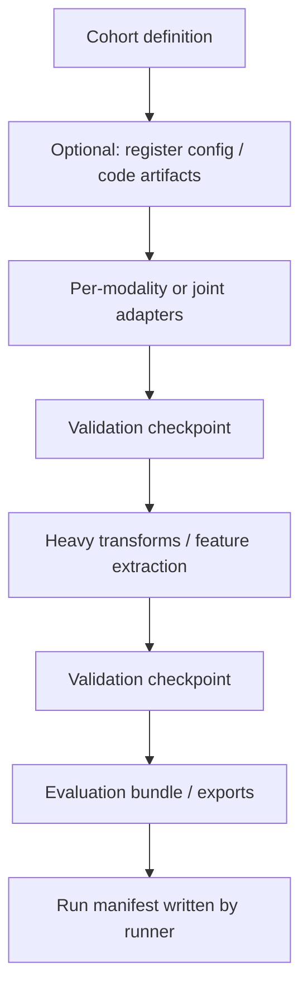

# Orchestrating a multistep multimodal research experiment with Tolkien

This guide is for researchers and engineers who want a **repeatable, file-based pipeline** across **multiple modalities** (e.g. imaging, clinical tables, omics, derived features) using the **Tolkien** library (`tolkien`): a **local workflow runner**, **run manifests**, **validation**, **cohort manifests**, and **artifact / lineage** helpers.

Tolkien is **domain-agnostic**. Your **modality-specific** steps live in **your own Python package(s)** and are invoked from a **workflow YAML**—the same pattern as `genfeat_mri` in this workspace.

For boundary detail, see [platform-vs-app.md](platform-vs-app.md). For a concrete ingest walkthrough, see [demo-ingestion-workflow.md](demo-ingestion-workflow.md).

---

## 1. What Tolkien does (and does not do)


| Tolkien provides                                                                      | Tolkien does *not* provide                                                         |
| ------------------------------------------------------------------------------------- | ---------------------------------------------------------------------------------- |
| A **minimal runner** that executes ordered shell commands from YAML                   | A full workflow engine (DAG retries, parallelism, resource scheduling)             |
| A shared `**GENFEAT_RUN_ID`** for subprocess steps                                    | Automatic linkage of that id into every tool unless your command reads the env var |
| A **run manifest** JSON (git commit, table hashes, step exit codes, declared outputs) | Verification that every declared output file exists                                |
| **Cohort manifest** generation from canonical `data/master/csv/*.csv`                 | Your cohort definition logic beyond CSV filters (custom scripts are fine)          |
| **Validation** CLI against your schema CSV contracts                                  | Study-specific statistical analysis                                                |
| **Artifact / primitive / lineage** helpers for cataloging paths and provenance        | Modality parsers (NIfTI, VCF, etc.)—those belong in your app                       |


**Design goal:** keep orchestration **boring and explicit** so experiments stay **auditable** and **git-friendly**.

---

## 2. Prerequisites

- **Python** ≥ 3.10.
- Install Tolkien in your environment (this repo: `pip install -e .` from the workspace root; elsewhere: vendor or publish the `tolkien/` package).
- **Repository layout** assumed by the bundled tools (you can mirror or adapt):
  - `data/master/csv/` — canonical tables (e.g. `patients`, `studies`, `series`, `files`, `patient_events`, …).
  - `data/master/schema/` — validation contracts and check lists.
  - `data/artifacts/` — cohort manifests, indexes, large derived assets.
  - `data/logs/validation/` — validation outputs.

---

## 3. The orchestration unit: workflow YAML

The runner loads the file with **PyYAML** (`yaml.safe_load`): valid YAML 1.1 features work (comments, flow mappings, multiline **folded** scalars via `>-` / `>`, anchors if you use them). The **schema** is still intentional: the runner only **executes** fields under each step’s `id`, `command`, and `outputs` (other keys on a step are ignored until future runner options use them).

### 3.1 Required structure

```yaml
workflow_name: my_multimodal_experiment
description: Short human-readable summary.

steps:
  - id: step_one
    command: python -m my_study.step_one --repo-root .
    outputs:
      - path/declared/output1.parquet
      - path/declared/output2.json

  - id: step_two
    command: python -m tolkien.validation.validate --repo-root . --run-id val_after_step_one
    outputs:
      - data/logs/validation/val_after_step_one_summary.md
```

**Rules:**

- `**workflow_name`** — becomes `run_type` in the **run manifest** (see §7).
- `**steps`** — ordered list.
- Each step needs `**id**` (optional; defaults to `step_0`, `step_1`, …) and `**command**` (string). The command is split with `**shlex.split**` for `subprocess` (no shell); use a **folded** YAML scalar or inline string so the effective command is one argv vector after normalization.
- `**outputs`** — optional list of **strings**; concatenated into the manifest’s `outputs` for audit. They are **not** checked for existence.

**Command shape:**

- Internal whitespace in `command` is normalized to single spaces (so folded block scalars become one line).
- Paths with spaces may need care on Windows with `shlex`; a wrapper script is the reliable escape hatch.

**Requires:** `PyYAML` installed (`pip install pyyaml`).

### 3.2 Running the workflow

From the **repository root** (or pass `--repo-root`):

```bash
tolkien-run-workflow configs/workflows/my_multimodal_experiment.yaml --repo-root .
# or
python -m tolkien.workflows.run_local_workflow configs/workflows/my_multimodal_experiment.yaml --repo-root .
```

**Dry run** (`--dry-run` on the runner): records step commands and return codes as zero without executing subprocesses—useful for CI or YAML linting.

---

## 4. Run identity: `GENFEAT_RUN_ID`

The runner sets `**GENFEAT_RUN_ID`** in the environment for **every** step subprocess:

- If unset before launch, it generates a value like `run_<12 hex chars>`.
- If **already** set (e.g. CI or notebook), that value is propagated.

**Why it matters for multimodal work**

- Downstream tools can stamp `**created_by_run_id`** on artifacts, events, or exports.
- Lineage edges can key off the same id so **all modalities in one experiment** share a **single run identifier**.

**Practice:** In custom scripts, read:

```text
os.environ.get("GENFEAT_RUN_ID", "")
```

and persist it in summaries or database rows when you need cross-modality joins later.

---

## 5. Recommended pattern for a multimodal experiment

Think in **layers**: **select subjects → harmonize tables → modality-specific ingest → mid-pipeline QC → analysis bundle → final QC**.




| Phase                 | Typical Tolkien module                                         | Typical application module                                     |
| --------------------- | -------------------------------------------------------------- | -------------------------------------------------------------- |
| Fix the analysis set  | `python -m tolkien.cohorts.cohort_manifest ...`                | Custom inclusion criteria script                               |
| Record inputs         | `tolkien.artifacts` (CLI or in code)                           | Study-specific asset registration                              |
| Tabular harmonization | `tolkien.adapters.clinical_csv_adapter` (or subclass patterns) | Modality adapters (e.g. imaging metadata)                      |
| QC                    | `python -m tolkien.validation.validate --run-id ...`           | —                                                              |
| Large binary outputs  | —                                                              | Your ingest (Zarr, archives, etc.); then register with Tolkien |
| Closing artifact      | —                                                              | Your “finalize” step: stats, bundles, collections              |


**Validation cadence:** schedule `**tolkien.validation.validate`** after **every** phase that mutates `data/master/csv/` or other contracted tables so failures **short-circuit** before expensive steps.

**Failure behavior:** if any step returns a **non-zero exit code**, the runner **stops** subsequent steps and marks the workflow **failed** in the manifest.

---

## 6. Cohort manifests (locking the sample)

Use Tolkien’s cohort helper when your cohort is **derivable from canonical CSVs** (patients → studies → series → files, with optional `--modality` filter):

```bash
python -m tolkien.cohorts.cohort_manifest \
  --repo-root . \
  --cohort-name multimodal_baseline_v1 \
  --cohort-manifest-id cohort_multimodal_baseline_v1 \
  --modality "" \
  --output-dir data/artifacts/cohort_manifests
```

**Semantics (high level):**

- Builds a JSON manifest with `**ids`** slices (e.g. `patient_uid`, `file_uid`, …) and embeds `**table_versions**` (hashes/timestamps) for reproducibility.
- Downstream commands consume the JSON path (e.g. `--cohort-manifest ...`) so **every later step uses the same subject set**.

For complex rules (multimodal intersection, lab thresholds), add a **custom Python step** earlier in the YAML and emit your own manifest JSON; you do not have to use `cohort_manifest.py`.

---

## 7. Run manifests (what gets recorded)

After a successful (or failed) **non-dry** workflow, the runner writes:

`data/artifacts/index/run_manifests/<run_id>.json`

**Useful fields** (from `tolkien.registry.run_manifest.build_manifest`):


| Field            | Purpose                                                |
| ---------------- | ------------------------------------------------------ |
| `run_id`         | Same as `GENFEAT_RUN_ID` for that invocation           |
| `run_type`       | Your `workflow_name`                                   |
| `status`         | `completed` or `failed`                                |
| `code_ref`       | `git rev-parse HEAD` (or `unknown`)                    |
| `input_tables`   | Per-CSV `sha256`, size, mtime under `data/master/csv/` |
| `outputs`        | Union of declared output paths from all steps          |
| `workflow_steps` | List of `{ id, command, return_code }`                 |
| `parameters`     | Includes path to workflow YAML and dry-run flag        |


**Using manifests in papers and audits**

- Cite `**run_id`** + `**code_ref**` + `**input_tables**` hashes as the **minimum reproducibility triple** for a multistep experiment.

---

## 8. Validation as quality gates

Invoke validation explicitly in the YAML:

```bash
python -m tolkien.validation.validate --repo-root . --run-id val_experiment_mid
```

**Operational tips:**

- Use **distinct** `--run-id` values per gate (`val_*`) so logs do not overwrite each other.
- Align `**run_id`** strings with entries you later store in `validation.validation_run_ids` if you extend manifests manually (the default `build_manifest` accepts `validation_run_ids` in code; the simple runner does not populate it automatically—for that, either post-process the JSON or call `build_manifest` from a custom finalizer).

---

## 9. Artifacts, entities, and lineage (cross-modality catalog)

When modalities produce **files or directories** you must cite in analysis:

1. **Register** with `tolkien.artifacts.register.build_artifact` (or the `python -m tolkien.artifacts.register` CLI with `--write`).
2. Mirror a **primitive entity** when you need a unified `entities.csv` graph.
3. Optionally append `**lineage_edges.csv`** (`tolkien.lineage.append_lineage_edges`) linking **source entities** (raw acquisition) → **derived artifacts** (processed tensors, features).

This gives you a **single catalog** spanning modalities without merging schemas prematurely.

---

## 10. Building your own steps (application package)

Pattern used in this repo:

1. Implement `**run() -> dict`** (JSON-serializable summary) in a module.
2. Expose `**python -m your_pkg.module**` with `argparse` and `if __name__ == "__main__"`.
3. Reference that module in the workflow `**command:**` line.
4. Optionally subclass a local `**ApplicationStep**` ABC for clarity (not required by Tolkien).

**Constraints:**

- Prefer **idempotent** writes or explicit overwrite policy when rerunning experiments.
- Exit **non-zero** on failure so the runner halts.
- Emit a small **JSON summary** path in stdout or a known path so operators can inspect runs without opening logs.

---

## 11. Command-line and portability notes

- The runner uses `**shlex.split`** for commands: avoid unescaped nested quotes; for complex invocations, use a `**scripts/run_phase.sh**` (Unix) or `**scripts/run_phase.ps1**` (Windows) and call that script in one line.
- **Working directory:** commands run with `cwd=--repo-root`; use **relative paths** in YAML when possible.
- **Windows:** ensure `python` on PATH matches your venv; path separators in **declared outputs** can stay POSIX-style for documentation consistency.

---

## 12. Checklist before you run a production experiment

- **Workflow YAML** checked in; `workflow_name` documents the study phase.
- **Cohort manifest** (or equivalent) versioned; id stable across reruns.
- **Validation** steps after each mutating phase.
- **GENFEAT_RUN_ID** understood by steps that register artifacts or lineage.
- **Run manifest** inspected (`run_manifests/<run_id>.json`) for `workflow_steps` and `input_tables`.
- **Large assets** registered and, if needed, lineage edges back to source file entities.

---

## 13. Where to look in this repository


| Goal                                           | Location                                                                                                  |
| ---------------------------------------------- | --------------------------------------------------------------------------------------------------------- |
| Full multistep example (MRI + generic Tolkien) | `configs/workflows/mri_baseline_experiment.yaml`                                                          |
| Ingest + register + lineage demo               | `configs/workflows/nifti_to_subject_zarr.yaml` + [demo-ingestion-workflow.md](demo-ingestion-workflow.md) |
| Runner implementation                          | `tolkien/workflows/run_local_workflow.py`                                                                 |
| Manifest schema builder                        | `tolkien/registry/run_manifest.py`                                                                        |


Tolkien stays **independent** of any one study; your multimodal experiment **orchestration** is `**workflow YAML + your packages`**. Tolkien supplies the **rails**: run id, ordering, manifests, validation hooks, and catalog primitives.