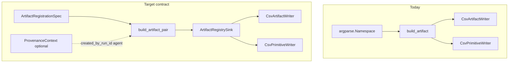

> **Related:**
- [[Architecture/Artifact Layer]]
- [[Workflows/Demo Ingestion Workflow]]
- [[Meta/Code Index]]
- [[Home]]

# Artifact registration contract (Tolkien)

> Design specification for layered artifact and optional entity registration. Companion to the [provenance workflow framework plan](../../../.cursor/plans/provenance_workflow_framework_8c619faa.plan.md): **lineage** is centralized via `ProvenanceSink`; **artifact catalog writes** get the same clarity—**who builds rows**, **who appends CSV**, **idempotency**, and **how `ProvenanceContext` supplies `run_id` / agent fields**.

Existing anchors (unchanged models / I/O):

- [`../../../tolkien/artifacts/models.py`](../../../tolkien/artifacts/models.py) — `Artifact`
- [`../../../tolkien/artifacts/register.py`](../../../tolkien/artifacts/register.py) — `build_artifact(args: argparse.Namespace)`
- [`../../../tolkien/artifacts/writer.py`](../../../tolkien/artifacts/writer.py) — `CsvArtifactWriter`
- [`../../../tolkien/primitives/writer.py`](../../../tolkien/primitives/writer.py) — `CsvPrimitiveWriter` (entity companion)
- Call sites today: [`nifti_to_subject_zarr.py`](../../../apps/genfeat_mri/genfeat_mri/ingest/nifti_to_subject_zarr.py), [`register_assets.py`](../../../apps/genfeat_mri/genfeat_mri/experiments/register_assets.py), [`mri_baseline_finalize.py`](../../../apps/genfeat_mri/genfeat_mri/experiments/mri_baseline_finalize.py)



---

## Layer 0 — Alignment with catalog semantics

| Concept | Tolkien today | Contract extension |
|---------|---------------|--------------------|
| **Artifact row** | `Artifact` dataclass + CSV shape | Same; builders produce validated `Artifact` |
| **Entity row** | Optional `Entity` from `build_artifact` | Same; optional `create_entity` flag on spec |
| **Run attribution** | `created_by_run_id`, `source_name` / `source_version` | Fill from **`ProvenanceContext`** (or explicit overrides) |
| **Idempotency** | Ingest scans `artifacts.csv` for active duplicate **`path_rel`** | Explicit **`RegistrationPolicy`** / resolver interface |

---

## Layer 1 — Typed registration specification (no `Namespace`)

Introduce a **dataclass** (or frozen attrs) **`ArtifactRegistrationSpec`** holding the same logical fields as the current `build_artifact` CLI/`Namespace` surface:

- Locator: `path_rel: str`, `uri: str`, `repo_root: Path`
- Classification: `artifact_type`, `artifact_role`, `schema_ref`, `media_type`, `format` (optional infer)
- Identity: optional `artifact_id`, `entity_id` (else stable id + `ent_<artifact_id>`)
- Provenance: `created_by_run_id`, `created_by_event_id`, `source_name`, `source_version`, `version`, `status`
- Payload: `metadata: dict[str, Any]`, `sha256` override, **`create_entity: bool`**, optional `name` for entity

**Normative rule:** all **programmatic** registration goes through **`ArtifactRegistrationSpec`**; **`argparse.Namespace`** remains only for `main()`—implemented as a thin adapter that builds `ArtifactRegistrationSpec` from parsed args.

---

## Layer 2 — Pure builder API

**`build_artifact_pair(spec: ArtifactRegistrationSpec) -> tuple[Artifact, Entity | None]`**

- Move / share logic from current [`build_artifact`](../../../tolkien/artifacts/register.py) (SHA256, directory byte_size, `stable_id`, `Entity` construction) so it depends on **spec**, not argparse.
- Keep **`build_artifact(ns)`** as a deprecated or wrapper `build_artifact_pair(namespace_to_spec(ns))` for backward compatibility.

Optional convenience:

- **`registration_spec_from_context(ctx: ProvenanceContext, **fields) -> ArtifactRegistrationSpec`** — fills `created_by_run_id`, default `source_name` / `source_version` from `ctx.agent_default`.

---

## Layer 3 — `ArtifactRegistrySink` (symmetric to `ProvenanceSink`)

Abstract **sink** for **where** rows are persisted (CSV today, DB tomorrow):

```python
class ArtifactRegistrySink(ABC):
    @abstractmethod
    def append_artifacts(self, artifacts: Iterable[Artifact]) -> None: ...

    @abstractmethod
    def append_entities(self, entities: Iterable[Entity]) -> None: ...  # no-op if empty
```

**Default:** **`CsvArtifactRegistrySink(repo_root: Path)`** — wraps `CsvArtifactWriter(repo_root / "data/master/csv/artifacts.csv")` and `CsvPrimitiveWriter` for `entities.csv`, **`append=True`**, preserves existing validation in `artifact.validate()`.

**Null sink** for tests / dry-run.

**Optional Phase II:** transactional batch (write both or neither) — not required for Phase I.

---

## Layer 4 — Registration policies (idempotency / dedup)

Abstract or small dataclass policy **`ArtifactRegistrationPolicy`**:

- **`skip_if_active_path_exists(path_rel_norm) -> bool`** — matches current Zarr ingest behavior conceptually.
- **`replace` / `error_on_duplicate`** — future.

**`resolve_registration(spec, existing_table_scan | ArtifactRegistryReader) -> Literal["insert", "skip"] | Artifact`** — keep interface narrow; first implementation can take an optional predicate callable supplied by the app.

**Rule:** **Tolkien** defines the **policy protocol**; **genfeat_mri** supplies path-normalization specifics if needed (e.g. Zarr root paths).

---

## Layer 5 — Integration with provenance workflow

- **`StepProvenanceRecord.generated_entities`** already carries **`ProvenanceEntityRef`**; optional extension: **`registered_artifacts: tuple[Artifact, ...]`** on the record **or** a parallel field **`artifact_specs`** to avoid heavy `Artifact` in every step.
- **`ProvenanceWorkflowRunner` (Phase II hook):** after each leaf, optionally invoke **`ArtifactRegistrySink`** from pairs produced by the step—**parallel to** `ProvenanceSink.append_edges`. Phase I can keep registration **inside** `ProvenancedStep` using **`CsvArtifactRegistrySink`** explicitly (same as today, but through the contract).

Recommended **incremental adoption:**

1. Introduce **spec + `build_artifact_pair` + sink**; migrate **one** call site ([`register_assets.py`](../../../apps/genfeat_mri/genfeat_mri/experiments/register_assets.py)).
2. Migrate **`nifti_to_subject_zarr`** `_register_zarr_artifact` to use spec + sink + policy.
3. Optionally add runner-level **dual flush** (edges + artifacts) when `StepProvenanceRecord` carries registrable payloads.

---

## Suggested file layout

| Path | Purpose |
|------|---------|
| [`../../../tolkien/artifacts/spec.py`](../../../tolkien/artifacts/spec.py) *(new)* | `ArtifactRegistrationSpec`, `namespace_to_spec` adapter |
| [`../../../tolkien/artifacts/register.py`](../../../tolkien/artifacts/register.py) | `build_artifact_pair`; keep `build_artifact` wrapper |
| [`../../../tolkien/artifacts/registry_sink.py`](../../../tolkien/artifacts/registry_sink.py) *(new)* | `ArtifactRegistrySink`, `CsvArtifactRegistrySink`, `NullArtifactRegistrySink` |
| [`../../../tolkien/artifacts/policy.py`](../../../tolkien/artifacts/policy.py) *(new, optional)* | `ArtifactRegistrationPolicy` protocol / simple implementations |
| [`../../../tolkien/provenance/context.py`](../../../tolkien/provenance/context.py) | Optional helper `registration_spec_from_context` **or** live in `artifacts/spec.py` with `TYPE_CHECKING` import |

**Rule:** no new imports of **genfeat_mri** from `tolkien`.

---

## Migration path (adopters)

1. Replace **hand-built Namespace** objects with **`ArtifactRegistrationSpec`**.
2. Route all CSV appends through **`CsvArtifactRegistrySink`** (single append mode and test doubles).
3. Centralize **idempotency** in one policy per workflow (ingest vs one-off CLIs).
4. When using **`ProvenanceWorkflowRunner`**, optionally emit **artifacts** the same way as **edges** (runner or step-local flush).

---

## Implementation checklist

- [ ] **art-spec**: Add `ArtifactRegistrationSpec` + `namespace_to_spec` in `tolkien/artifacts/spec.py`.
- [ ] **art-builder**: Refactor `build_artifact` body into `build_artifact_pair(spec)`; keep backward-compatible `build_artifact(ns)`.
- [ ] **art-sink**: Add `ArtifactRegistrySink` + CSV + null implementations in `tolkien/artifacts/registry_sink.py`.
- [ ] **art-policy**: Add minimal `skip_if_path_active` policy hook used by Zarr ingest migration.
- [ ] **art-migrate-genfeat**: Migrate `nifti_to_subject_zarr` and one small script to the new API; leave other call sites as follow-ups.

---

**Up:** [[Home]]
