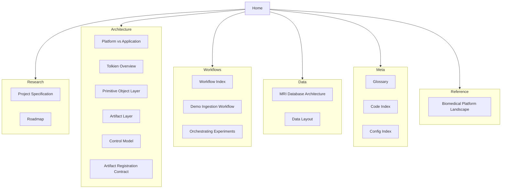
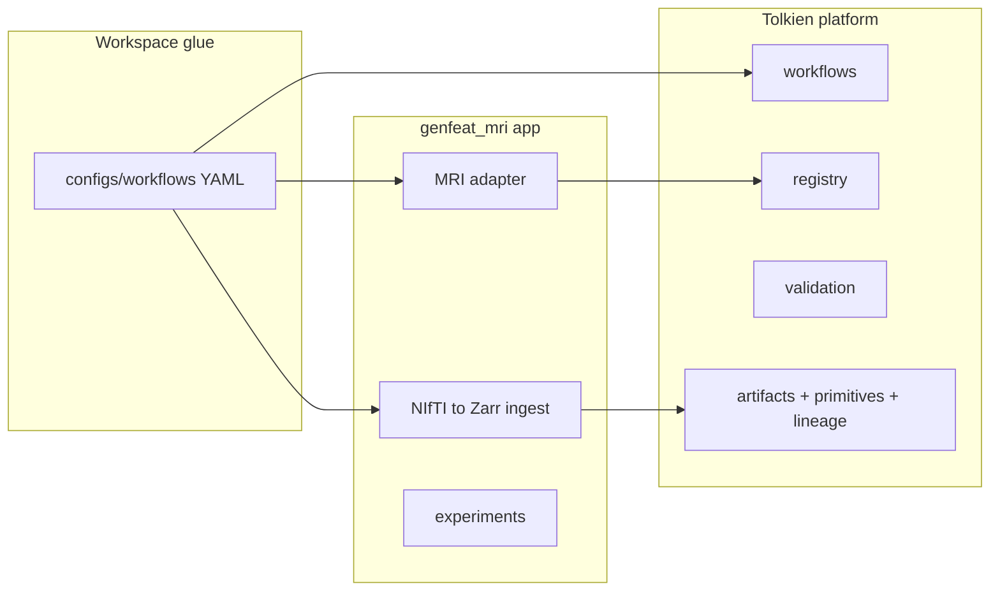

> **Related:** [[Research/Project Specification]] · [[Architecture/Tolkien Overview]] · [[Workflows/Workflow Index]] · [[Meta/Glossary]]

# genfeat-mri documentation vault

Study-specific **3D brain MRI domain-generalization** research, built on the **Tolkien** platform library. Canonical source docs live in [`docs/`](../); this vault adds navigation, wikilinks, and cross-references.

## Quick paths

| I want to… | Start here |
|------------|------------|
| Understand the research goal | [[Research/Project Specification]] |
| See platform vs MRI app boundary | [[Architecture/Platform vs Application]] |
| Run NIfTI → Zarr ingest | [[Workflows/Demo Ingestion Workflow]] |
| Run a full baseline experiment | [[Workflows/Workflow Index]] |
| Learn Tolkien architecture | [[Architecture/Tolkien Overview]] |
| Look up a term | [[Meta/Glossary]] |
| Find Python modules | [[Meta/Code Index]] |
| Find workflow YAMLs | [[Meta/Config Index]] |
| Understand data layout | [[Meta/Data Layout]] |

## Vault map

## All notes

| Section | Notes |
|---------|-------|
| **Research** | [[Research/Project Specification]], [[Research/Roadmap]] |
| **Architecture** | [[Architecture/Platform vs Application]], [[Architecture/Tolkien Overview]], [[Architecture/Primitive Object Layer]], [[Architecture/Artifact Layer]], [[Architecture/Control Model]], [[Architecture/Artifact Registration Contract]] |
| **Workflows** | [[Workflows/Workflow Index]], [[Workflows/Demo Ingestion Workflow]], [[Workflows/Orchestrating Multimodal Experiments]] |
| **Data** | [[Data/MRI Database Architecture]], [[Meta/Data Layout]] |
| **Meta** | [[Meta/Glossary]], [[Meta/Code Index]], [[Meta/Config Index]] |
| **Reference** | [[Reference/Biomedical Platform Landscape]] |

## Platform stack (one glance)

See [[Architecture/Platform vs Application]] for the hard boundary rule: **Tolkien never imports genfeat_mri**.

---

**Canonical docs:** [`docs/`](../) · **Install:** `pip install -e .` from repo root
