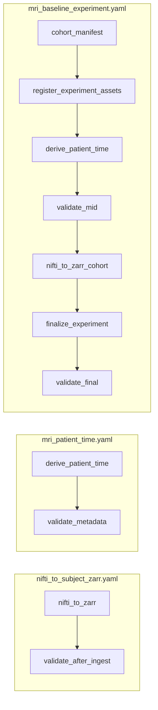

> **Related:** [[Workflows/Workflow Index]] · [[Workflows/Demo Ingestion Workflow]] · [[Meta/Code Index]] · [[Home]]

# Config Index

Workflow and source policy YAML files that glue Tolkien + genfeat_mri.

## Workflow YAML (`configs/workflows/`)

| File | Purpose | Vault guide |
|------|---------|---------------|
| [`nifti_to_subject_zarr.yaml`](../../../configs/workflows/nifti_to_subject_zarr.yaml) | Ingest → validate | [[Workflows/Demo Ingestion Workflow]] |
| [`mri_patient_time.yaml`](../../../configs/workflows/mri_patient_time.yaml) | MRI adapter → validate | [[Architecture/Platform vs Application#genfeat_mri]] |
| [`mri_baseline_experiment.yaml`](../../../configs/workflows/mri_baseline_experiment.yaml) | Full baseline (7 steps) | [[Workflows/Workflow Index]] |

Run any workflow:

```bash
tolkien-run-workflow configs/workflows/nifti_to_subject_zarr.yaml --repo-root .
```

## Source policies (`configs/sources/`)

| File | Consumed by | Key settings |
|------|-------------|--------------|
| [`zarr_ingest_brats.yaml`](../../../configs/sources/zarr_ingest_brats.yaml) | `NiftiToSubjectZarrIngest` | chunk_shape, resample_policy, dataset_slug |
| [`brats2020_mri.yaml`](../../../configs/sources/brats2020_mri.yaml) | `MriAdapter` | raw_roots, canonical_inputs, outputs |

## Frozen experiment config

| File | Role |
|------|------|
| [`mri_baseline_v1.yaml`](../../../data/artifacts/configs/experiments/mri_baseline_v1.yaml) | Registered experiment plan (cohort, ingest limit, workflow pointer) |

## Workflow → step → module map



| Step id | Module |
|---------|--------|
| `nifti_to_zarr` | `genfeat_mri.ingest.nifti_to_subject_zarr` |
| `derive_patient_time` | `genfeat_mri.adapters.mri_adapter` |
| `cohort_manifest` | `tolkien.cohorts.cohort_manifest` |
| `register_experiment_assets` | `genfeat_mri.experiments.register_assets` |
| `finalize_experiment` | `genfeat_mri.experiments.mri_baseline_finalize` |
| `validate_*` | `tolkien.validation.validate` |

---

**Up:** [[Home]]
