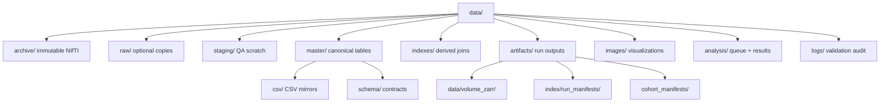

> **Related:** [[Data/MRI Database Architecture]] · [[Workflows/Demo Ingestion Workflow#17. File touch list]] · [[Architecture/Tolkien Overview#2. On-disk layout]] · [[Home]]

# Data Layout

File-first metadata architecture for 3D brain MRI research. Canonical source: [`data/README.md`](../../../data/README.md).

## Principles

- Keep upstream data **immutable** in `archive/`
- **Pseudonymized IDs** only in repository tables
- Paths are **relative to repo root**
- Soft-delete via `is_active = false`
- Provenance fields on every master table row

## Directory tree

## Master CSV tables (`data/master/csv/`)

| Table | Role | Written by |
|-------|------|------------|
| `patients.csv` | Patient scaffold | Ingest / build pipeline |
| `studies.csv` | Study metadata | Ingest / build pipeline |
| `series.csv` | Series metadata | Ingest / build pipeline |
| `files.csv` | NIfTI file registry (~2345 rows) | Ingest / build pipeline |
| `patient_events.csv` | Patient-time spine events | [[Architecture/Platform vs Application#genfeat_mri\|MriAdapter]] |
| `modality_observations.csv` | Imaging observations | MriAdapter |
| `artifacts.csv` | Registered artifact catalog | Ingest register, experiments |
| `entities.csv` | Primitive entity mirror | Register steps |
| `events.csv` | Primitive events | Finalize step |
| `observations.csv` | Primitive observations | Finalize step |
| `relations.csv` | Primitive relations | Finalize step |
| `lineage_edges.csv` | Derivation edges | Ingest `--lineage` |
| `labels_outcomes.csv` | Outcome labels | — |

Schema contracts: `data/master/schema/` · column dictionary in `column_dictionary.md`

## Canonical IDs

See [[Meta/Glossary#Imaging scaffold IDs]] — policy in `data/master/schema/id_policy.md`.

## Key artifact paths

| Path | Content |
|------|---------|
| `data/artifacts/data/volume_zarr/brats2020/` | Per-patient multimodal Zarr (5 subjects in baseline slice) |
| `data/artifacts/index/ingestion_reports/` | Ingest JSON summaries |
| `data/artifacts/index/run_manifests/` | Workflow run manifests |
| `data/artifacts/cohort_manifests/` | Cohort JSON filters |
| `data/artifacts/evaluation_bundles/` | Evaluation bundle manifests |
| `data/logs/validation/` | Validation JSONL + markdown summaries |

## Multimodal spine

Before analysis, records attach to a patient-time spine:

- **`patient_events`** — timeline entries keyed by `patient_uid`
- **`modality_observations`** — modality facts linked to events + optional `file_uid`
- **`lineage_edges`** — PROV-style derivation between files, activities, artifacts

Native volumes stay in `archive/` or registered artifact locations; tables hold metadata only.

## Update SOP

1. Add source drop under `archive/`
2. Normalize into `staging/` + schema checks
3. Build/update `master/` tables
4. Rebuild `indexes/`
5. Register outputs in artifact/analysis registries
6. Run validation from `master/schema/validation_checks.yaml`
7. Append outcomes to `logs/`

## Security

- No direct PHI in repo tables
- Reversible mapping stays external

Future architecture: [[Data/MRI Database Architecture]] (Parquet, DuckDB, Iceberg path).

---

**Up:** [[Home]]
