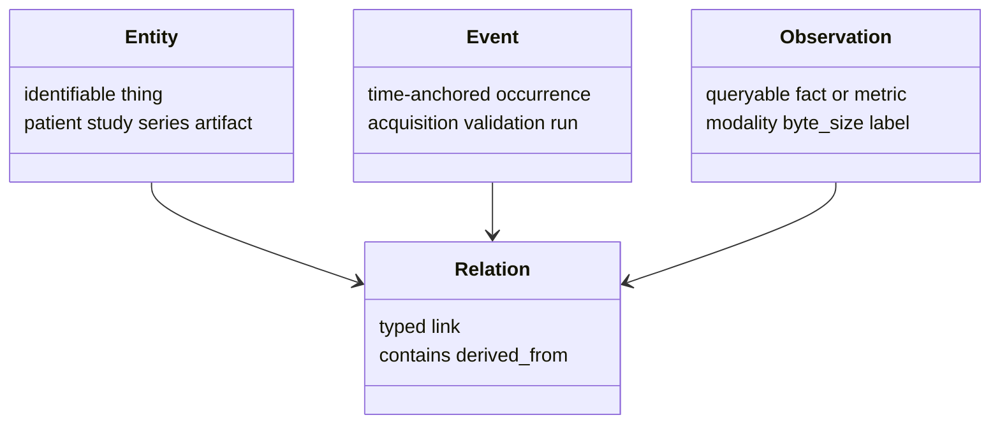

> **Related:** [[Architecture/Primitive Object Layer]] · [[Architecture/Artifact Layer]] · [[Architecture/Tolkien Overview]] · [[Home]]

# Glossary

Key terms used across the genfeat-mri vault. Each entry links to the authoritative note.

## Primitive model

| Term | Definition | See |
|------|------------|-----|
| **Entity** | Identifiable thing with stable identity and lifecycle | [[Architecture/Primitive Object Layer#Entity]] |
| **Event** | Time-anchored occurrence (absolute or relative) | [[Architecture/Primitive Object Layer#Event]] |
| **Observation** | Queryable fact, metric, label, or reference — not large arrays | [[Architecture/Primitive Object Layer#Observation]] |
| **Relation** | Typed link between primitives (contains, derived_from, …) | [[Architecture/Primitive Object Layer#Relation]] |
| **Artifact** | Specialized Entity for stored, versioned, reproducible objects | [[Architecture/Artifact Layer]] |

## Artifact types

| Type | Examples |
|------|----------|
| `data_artifact` | Zarr volumes, feature tables, masks |
| `model_artifact` | Checkpoints, weights |
| `configuration_artifact` | Workflow YAML, ingest policy, cohort defs |
| `report_artifact` | Validation summaries, model cards |
| `visual_artifact` | MRI slices, training curves |
| `environment_artifact` | Lockfiles, container digests |
| `collection_artifact` | Evaluation bundles, cohort packages |

## Orchestration & provenance

| Term                  | Definition                                                            | See                                                                                         |
| --------------------- | --------------------------------------------------------------------- | ------------------------------------------------------------------------------------------- |
| **GENFEAT_RUN_ID**    | Shared run identifier injected by workflow runner into subprocess env | [[Workflows/Orchestrating Multimodal Experiments#4. Run identity: GENFEAT_RUN_ID]]          |
| **Run manifest**      | JSON audit record under `data/artifacts/index/run_manifests/`         | [[Architecture/Tolkien Overview#4. Two orchestration modes]]                                |
| **Lineage edge**      | PROV-style derivation link in `lineage_edges.csv`                     | [[Workflows/Demo Ingestion Workflow#11. Lineage (Tolkien)]]                                 |
| **Cohort manifest**   | JSON filter of patient/file UIDs + table version hashes               | [[Workflows/Orchestrating Multimodal Experiments#6. Cohort manifests (locking the sample)]] |
| **ApplicationStep**   | genfeat_mri contract: `run() -> dict` JSON summary                    | [[Workflows/Demo Ingestion Workflow#5. Ingest class: programmatic surface]]                 |
| **DatastoreRegistry** | Tolkien single write gateway for master CSVs, lineage, manifests      | [[Architecture/Tolkien Overview#3. Core registry flow]]                                     |
| **MasterTableReader** | Tolkien single read gateway for master CSV mirrors                    | [[Architecture/Platform vs Application]]                                                    |

## Imaging scaffold IDs

| ID | Role |
|----|------|
| `patient_uid` | Pseudonymized patient |
| `study_uid` | One imaging study / session |
| `series_uid` | One modality series within a study |
| `file_uid` | One NIfTI file row in `files.csv` |
| `event_uid` | Patient-time spine event |
| `observation_uid` | Modality observation row |
| `lineage_edge_id` | Stable hash of a lineage edge |
| `artifact_id` | Registered artifact catalog row |

Policy: [[Meta/Data Layout]] · schema in `data/master/schema/id_policy.md`

## genfeat_mri-specific

| Term | Definition | See |
|------|------------|-----|
| **NiftiToSubjectZarrIngest** | NIfTI → per-patient Zarr step | [[Workflows/Demo Ingestion Workflow]] · [`nifti_to_subject_zarr.py`](../../../apps/genfeat_mri/genfeat_mri/ingest/nifti_to_subject_zarr.py) |
| **MriAdapter** | studies/series/files → patient_events + modality_observations | [[Architecture/Platform vs Application#genfeat_mri]] · [`mri_adapter.py`](../../../apps/genfeat_mri/genfeat_mri/adapters/mri_adapter.py) |
| **from_mri_scaffold** | Maps imaging CSVs → Entity/Event/Observation/Relation | [`from_mri_scaffold.py`](../../../apps/genfeat_mri/genfeat_mri/primitives/from_mri_scaffold.py) |
| **subject_volume_zarr** | Artifact role for per-patient Zarr stores | [[Workflows/Demo Ingestion Workflow#10. Registration]] |

## Datasets

| Term | Role |
|------|------|
| **BraTS2020** | Primary archive dataset under `data/archive/` |
| **brats2020** | `dataset_slug` for Zarr output path segment |
| **local_mri_exploration** | `source_name` for canonical master table rows |

---

**Up:** [[Home]]
