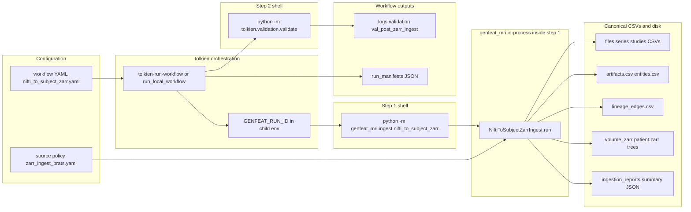
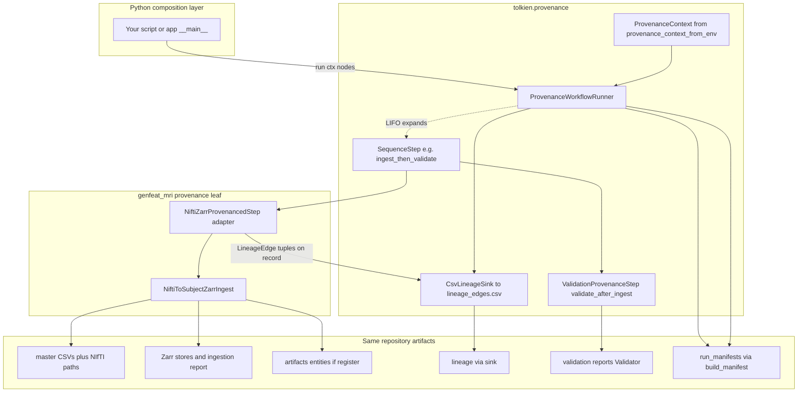
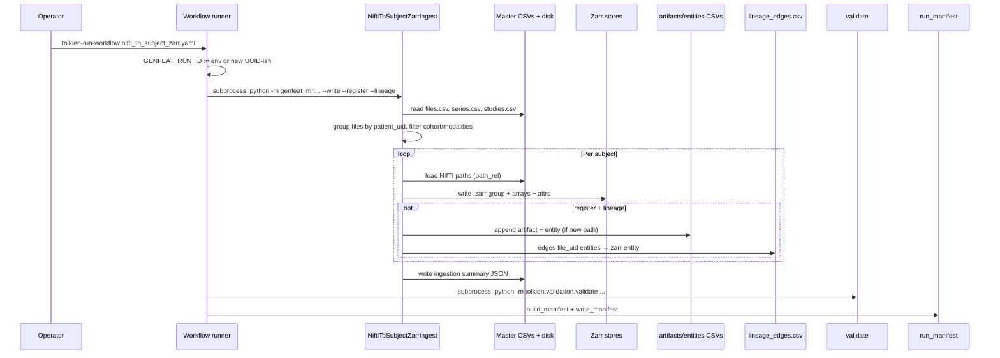
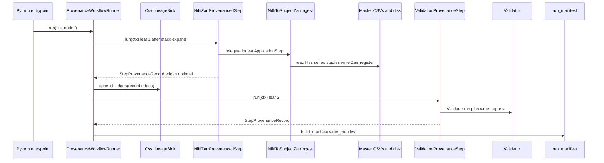
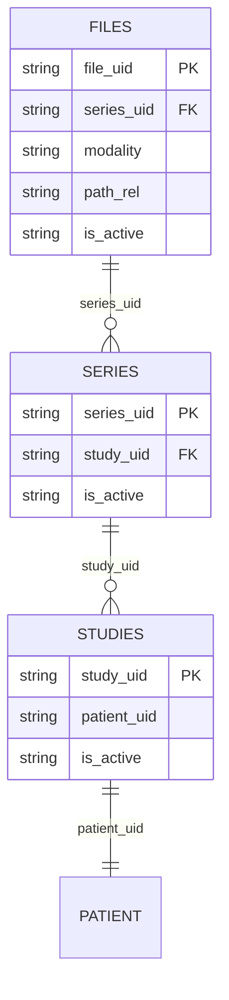

> **Related:**
- [[Architecture/Tolkien Overview]]
- [[Architecture/Platform vs Application]]
- [[Meta/Config Index]]
- [[Meta/Code Index]]
- [[Workflows/Workflow Index]]
- [[Home]]

# Demo: Ingestion workflow (programmatic and semantic map)

This document is an **end-to-end map** of the **NIfTI → per-subject Zarr** ingestion path used in this workspace. It shows how **Tolkien** (codename for the domain-agnostic library) supplies **artifacts, primitives, lineage, validation, workflows, manifests**, and—optionally—the **in-process provenance runner** (`tolkien.provenance`), while **genfeat_mri** supplies the **study-specific ingest** (`ApplicationStep`) and MRI/NIfTI logic.

---

## 1. Responsibility split (what is “platform” vs “app”)

| Layer                            | Package / location                                                 | Role in this demo                                                                                                                                                                                                                                                                                                                                                                                                   |
| -------------------------------- | ------------------------------------------------------------------ | ------------------------------------------------------------------------------------------------------------------------------------------------------------------------------------------------------------------------------------------------------------------------------------------------------------------------------------------------------------------------------------------------------------------- |
| **Orchestration (shell / YAML)** | `tolkien.workflows.run_local_workflow`                             | Parses YAML, runs shell steps, sets `GENFEAT_RUN_ID`, writes **run manifest**. This is what the bundled **nifti_to_subject_zarr** workflow uses today.                                                                                                                                                                                                                                                              |
| **Orchestration (in-process)**   | `tolkien.provenance.runner.ProvenanceWorkflowRunner`               | Runs **Python** `ProvenancedStep` nodes with a **LIFO work stack**, flushes **`LineageEdge`** rows through a **`ProvenanceSink`** after each **leaf** step, and writes the same **run manifest** helpers (`build_manifest` / `write_manifest`). Optional **`JsonCheckpointStore`**, retries, and **`ValidationProvenanceStep`**. Not used by the default YAML demo unless you compose a runner entrypoint yourself. |
| **Provenance & catalog**         | `tolkien.artifacts.*`, `tolkien.primitives.*`, `tolkien.lineage.*` | Registers Zarr paths as **artifacts**, mirrors **entity** rows, appends **lineage** edges.                                                                                                                                                                                                                                                                                                                          |
| **Quality gate**                 | `tolkien.validation.validate`                                      | Post-ingest checks over canonical CSVs / schema (second workflow step).                                                                                                                                                                                                                                                                                                                                             |
| **Ingest implementation**        | `genfeat_mri.ingest.nifti_to_subject_zarr`                         | Reads master **files / series / studies**, builds Zarr stores, optional register + lineage.                                                                                                                                                                                                                                                                                                                         |
| **Step contract**                | `genfeat_mri.steps.base.ApplicationStep`                           | Abstract `run()` → JSON-serializable summary (ingest class implements this).                                                                                                                                                                                                                                                                                                                                        |

**Invariant:** Tolkien never imports genfeat_mri; the **workflow YAML** (or your own Python composition using `ProvenanceWorkflowRunner`) is the composition layer.

---

## 2. End-to-end topology (two orchestration graphs)

The same **NIfTI → Zarr → register → lineage → validate** semantics can be driven either by the **bundled subprocess workflow** (`tolkien-run-workflow` / `run_local_workflow`) or by an **in-process** graph built with **`ProvenanceWorkflowRunner`** and **genfeat_mri**-backed **`ProvenancedStep`** leaves. The graphs below are **separate**; do not mix edges between them.

### 2.1 Subprocess flow (YAML + `run_local_workflow`) — matches run script today

This is the path implied by **`configs/workflows/nifti_to_subject_zarr.yaml`**: each step is a **shell command**; **`GENFEAT_RUN_ID`** is injected into the child environment; lineage is written **inside** the ingest subprocess when `--lineage` is passed.



### 2.2 In-process flow (`ProvenanceWorkflowRunner` + genfeat_mri steps)

Here a **Python entrypoint** builds **`WorkflowNode`** instances (for example a **`SequenceStep`** over **ingest** then **validation**). The runner supplies **`ProvenanceContext`**; after each **leaf**, **`ProvenanceSink.append_edges`** records lineage (**`CsvLineageSink`** → `lineage_edges.csv`). A thin **`ProvenancedStep`** in **genfeat_mri** (or local script) delegates to **`NiftiToSubjectZarrIngest`** and returns **`StepProvenanceRecord`** including **`edges`** when using runner-managed lineage—**or** the adapter keeps calling ingest’s internal `--lineage` behavior until you fully migrate edges to the record.



**Naming note:** **`NiftiZarrProvenancedStep`** is a **placeholder** for the study-specific **`ProvenancedStep`** you implement (subclass **`ProvenancedStep`**, `step_id` e.g. `nifti_to_zarr`, **`run(ctx)`** calling **`NiftiToSubjectZarrIngest`** with repo paths from **`ctx.repo_root`**). Tolkien does not define that class; **genfeat_mri** owns it once you add it.

---

## 3. Sequence: workflow invocations

### 3.1 Subprocess workflow (`run_local_workflow`) — single demo run

When you run the bundled workflow, two **steps** execute in order; both inherit the same `GENFEAT_RUN_ID` if the runner created it (or your preset env var).



### 3.2 In-process graph (`ProvenanceWorkflowRunner` + genfeat adapter)

Same logical ordering as §2.2: the **runner** expands **`SequenceStep`**, runs **`NiftiZarrProvenancedStep`**, flushes **`record.edges`** to **`CsvLineageSink`**, then runs **`ValidationProvenanceStep`**. No subprocess boundary between ingest and validation unless the adapter internally shells out (not required).



---

## 4. Workflow YAML (declared vs actual behavior)

Reference: `configs/workflows/nifti_to_subject_zarr.yaml`.

| Field | Meaning |
|--------|---------|
| `workflow_name` | Becomes `run_type` in the **run manifest** (`build_manifest`). |
| `source_config` | **Declarative pointer** to the ingest policy file (not parsed by the runner; ingest uses `--config` in the command). |
| `steps[].id` | Logical step name; recorded in `workflow_steps` in the manifest. |
| `steps[].command` | Shell command executed with `cwd = --repo-root`. |
| `steps[].outputs` | **Declared** paths folded into the manifest’s `outputs` list (for auditing; not verified as existing files by the runner). |

**Runner semantics (`run_local_workflow.py`):**

- Loads the workflow with **`yaml.safe_load`** (full YAML syntax for the file).
- Sets `child_env["GENFEAT_RUN_ID"]` for every subprocess.
- On first failing return code, **stops** subsequent steps (`break` after recording failure).
- Writes manifest under `data/artifacts/index/run_manifests/` via `write_manifest`.

### 4.1 In-process alternative: `ProvenanceWorkflowRunner` (`tolkien.provenance`)

**Topology for this mode:** §2.2 and §3.2.

For **Python-native** pipelines (no subprocess per step), Tolkien provides **`ProvenanceWorkflowRunner`**, which:

- Builds a **`ProvenanceContext`** (e.g. `provenance_context_from_env(repo_root, workflow_name=…)` — honors `GENFEAT_RUN_ID` when set).
- Schedules **`WorkflowNode`** instances using a **LIFO work stack**: top-level nodes are **pushed in reverse** so declared order matches execution order; **`SequenceStep`** composites expand by **pushing children in reverse** so children run **depth-first** in source order.
- On each **leaf** **`ProvenancedStep.run(ctx)`**, interprets **`StepOutcome`** (`SUCCESS`, `STOP_WORKFLOW`, `FAIL`, `RETRY_STEP`) with optional retries, then **`ProvenanceSink.append_edges(record.edges)`** — steps **return** edges; they do **not** write CSV themselves.
- Uses the same registry helpers for the final artifact: **`build_manifest`** / **`write_manifest`**, and adds **`workflow_steps`** entries shaped as `{ id, outcome, iteration }` (contrast: the YAML runner records `command` and `return_code` per step).

Use **`CsvLineageSink(repo_root / "data/master/csv/lineage_edges.csv")`** to match the canonical lineage table path. **`ValidatedStep`** / **`ValidationProvenanceStep`** (or **`ValidationGate`**) can run **`tolkien.validation.validate`** in-process instead of a second shell step.

**This demo workflow** still uses **`run_local_workflow`**; the provenance runner is the extension point when you wrap **`NiftiToSubjectZarrIngest`** (or a thin adapter) as a **`ProvenancedStep`** and move lineage emission to **`StepProvenanceRecord.edges`** + sink.

---

## 5. Ingest class: programmatic surface

`NiftiToSubjectZarrIngest` subclasses `ApplicationStep` and sets `step_id = "nifti_to_subject_zarr"`.

### 5.1 Constructor parameters

| Parameter | Type | Role |
|-----------|------|------|
| `repo_root` | `Path` | Root of the workspace; all relative paths resolve here. |
| `config_path` | `Path` | Ingest policy YAML/JSON (`load_config`). |
| `cohort_manifest` | `Path | None` | Optional JSON; may restrict to `ids.file_uid` (see §8). |
| `limit` | `int` | Max **patients** after grouping (`0` = all). |
| `dry_run` | `bool` | CLI `--dry-run`; also forced when `write` is false (see below). |
| `write` | `bool` | If false, **no Zarr write**; `dry_run` effective. |
| `register` | `bool` | Append `artifacts.csv` / `entities.csv` for each successful store. |
| `lineage` | `bool` | Append `lineage_edges.csv` when `register` produced an entity id and `GENFEAT_RUN_ID` non-empty. |
| `summary_path` | `Path | None` | Override default ingestion summary path. |

**Effective dry-run:** `dry_run = cli_dry_run or not write` inside `run()`.

### 5.2 Public entrypoints

- **`run()`** → `dict` summary (JSON-serializable) including `results`, `subjects_selected`, `summary_path`, `genfeat_run_id`.
- **`from_argparse(ns)`** → constructs from CLI `argparse.Namespace`.
- **`main()`** (module `__main__`) → CLI; **exits 1** if any subject record has `status == "failed"`.

---

## 6. Ingest policy config (`zarr_ingest_brats.yaml`)

Keys consumed by `process_subject` / `run()`:

| Key | Example / default | Semantic |
|-----|-------------------|----------|
| `dataset_slug` | `brats2020` | Directory segment: `data/artifacts/data/volume_zarr/<slug>/`. |
| `schema_version` | `1` | Stored in Zarr **group attrs** and artifact `schema_ref` suffix. |
| `source_name` | `nifti_zarr_ingest` | Provenance: artifact + lineage metadata. |
| `source_version` | `v1` | Provenance: artifact + lineage metadata. |
| `chunk_shape` | `[32,32,32]` | Zarr chunk size per axis (clamped to array shape). |
| `compressor` | `blosc_zstd`, `clevel` | Blosc compressor for Zarr arrays (`make_compressor`). |
| `default_dtype` | `float32` | Numpy dtype for modalities not in `dtype_map`. |
| `dtype_map` | e.g. `seg: uint8` | Per-modality dtype; integers use `round` before cast. |
| `resample_policy` | `none` \| `reference_modality` | If `reference_modality`, resample all volumes to reference grid (`nibabel.processing.resample_from_to`). |
| `reference_modality` | `flair` | Reference series when resampling; fallback if missing. |
| `expected_modalities` | list or `[]` | If non-empty, **filter** file rows to those modalities only. |

---

## 7. Master CSV join semantics (input graph)

Ingest builds a logical join:



**`group_files_by_patient` rules (behavioral checklist):**

- Skip inactive rows (`is_active` == `"false"` case-insensitive) on **file**, **series**, and **study**.
- If `cohort_uids` present: keep only files whose `file_uid` is in the cohort set.
- If `expected_modalities` non-empty: modality must be in that set.
- Require non-empty `patient_uid` on the resolved study.
- Output: `dict[patient_uid, list[file_row]]`.

**Per-patient file set (`process_subject`):**

- Sorts file rows by `file_uid`.
- **One row per modality:** if a second file maps to the same modality → `status: skipped`, `reason: duplicate modality <mod>`.

---

## 8. Cohort manifest JSON (optional filter)

`load_cohort_file_uids(path)` expects JSON with optional structure:

```json
{ "ids": { "file_uid": ["...", "..."] } }
```

- If `ids.file_uid` absent → **no cohort filter** (`None`).
- If present → only those `file_uid` values participate in grouping.

This keeps cohort definitions **outside** Tolkien; the ingest step only consumes a filtered id list.

---

## 9. Per-subject processing (NIfTI → Zarr)

### 9.1 Status values on each result record

| `status` | Meaning |
|----------|---------|
| `dry_run` | No Zarr write; lists modalities, relative path, source file uids. |
| `skipped` | Logical skip (e.g. duplicate modality). |
| `failed` | Missing file, non-3D after squeeze, shape mismatch under `resample_policy: none`, etc. |
| `ok` | Store written; includes `byte_size` when not dry-run. |

### 9.2 Resampling and dtype

- **`reference_modality`:** `seg` uses **order=0** (nearest); others **order=1** (linear) when resampling.
- **Affine / spacing:** Group attrs store `affine` (4×4 list) and `voxel_size_mm` from the reference image’s header zooms.
- **`resample_policy: none`:** All aligned volumes must share the same shape or subject **fails**.

### 9.3 Zarr layout

- **Group path:** `data/artifacts/data/volume_zarr/<dataset_slug>/<patient_uid>.zarr/`
- **Arrays:** one dataset per modality; **Zarr key** = `sanitize_key(modality)` (non-alnum → `_`, lowercased).
- **Root group attributes (semantic snapshot):**

| Attribute | Role |
|-----------|------|
| `patient_uid`, `dataset_slug`, `schema_version` | Identity and schema generation. |
| `converter` | Fixed string `nifti_to_subject_zarr`. |
| `modalities`, `modality_zarr_keys` | Channel map for consumers. |
| `source_file_uids`, `nifti_path_rel` | Traceability back to `files.csv`. |
| `resample_policy`, `reference_modality` | Processing provenance. |
| `affine`, `voxel_size_mm` | Geometry for downstream tools. |

---

## 10. Registration (Tolkien artifacts + primitive entities)

When `--register` and subject `status == ok`:

1. **Idempotency check:** scans `artifacts.csv` for an **active** row with same normalized `path_rel`; if found, returns existing `artifact_id` / `entity_id` (**no duplicate append**).

2. **`build_artifact` (`tolkien.artifacts.register`):**

   - Computes stable `artifact_id` from type, role, locator (`stable_id` over `art`, …).
   - Sets `entity_id` default `ent_<artifact_id>`.
   - For a **directory** (Zarr store root), **byte_size** = sum of file sizes under tree (artifact row); **sha256** empty string at directory level in current logic.
   - **`create_entity`:** produces `Entity` with `entity_type="artifact"` and metadata linking back to the artifact.

3. **Writes:**

   - `CsvArtifactWriter(artifacts.csv).write([artifact], append=...)`
   - `CsvPrimitiveWriter(csv_dir).write([entity], append=...)` → `entities.csv`

**Typical semantic labels for this ingest:**

| Field | Value used |
|-------|------------|
| `artifact_type` | `data_artifact` |
| `artifact_role` | `subject_volume_zarr` |
| `media_type` | `application/x-zarr` |
| `format` | `zarr` |
| `schema_ref` | `genfeat.subject_zarr.v<schema_version>` |
| `created_by_run_id` | `GENFEAT_RUN_ID` when set |
| `created_by_event_id` | `""` (explicit blank in ingest) |

`metadata_json` payload includes `patient_uid`, `modalities`, `schema_version`.

---

## 11. Lineage (Tolkien)

When `--lineage`, `register` produced `entity_id`, and `GENFEAT_RUN_ID` is non-empty:

- For each **source file uid** in the subject’s `file_uid_list`, ingest appends a **`LineageEdge`**:

| Field | Value |
|-------|-------|
| `activity_type` | `transform` |
| `source_entity_type` / `target_entity_type` | `entity` |
| `source_entity_id` | `ent_<file_uid>` if not already prefixed with `ent_` |
| `target_entity_id` | Zarr artifact **entity** id |
| `derivation_type` | `derived_from` |
| `agent_type` | `script` (default on dataclass) |
| `agent_id` | **`nifti_to_subject_zarr`** (`step_id`) |
| `source_name` / `source_version` | From ingest config |

**Persistence:** `append_lineage_edges` → `data/master/csv/lineage_edges.csv` with stable `lineage_edge_id` (`stable_uid` hash of edge key fields).

**Provenance-framework path:** If you orchestrate with **`ProvenanceWorkflowRunner`**, lineage CSV writes should go through **`CsvLineageSink`** (which wraps `append_lineage_edges`) after each leaf step, using **`LineageEdge`** instances attached to **`StepProvenanceRecord.edges`**. The **YAML + ingest** path documented here still writes lineage **inside** the ingest process when `--lineage` is set.

**Semantic note:** Edges assert **NIfTI file entities → derived Zarr entity** for this run; consumers can traverse provenance keyed by `run_id`.

---

## 12. Ingestion summary JSON

Default path pattern:

`data/artifacts/index/ingestion_reports/zarr_<dataset_slug>_summary.json`

Top-level keys:

| Key | Content |
|-----|---------|
| `step_id` | `nifti_to_subject_zarr` |
| `config_path` | Resolved config file string |
| `cohort_manifest` | Path string or empty |
| `dry_run` | Boolean (effective) |
| `subjects_selected` | Count of patients in this run slice |
| `results` | List of per-subject dicts (`status`, paths, uids, errors, …) |
| `genfeat_run_id` | Env at time of `run()` |
| `summary_path` | Added before return |

---

## 13. Post-ingest validation (second workflow step)

`python -m tolkien.validation.validate --repo-root . --run-id val_post_zarr_ingest`

- Separate **Tolkien** module; operates on the canonical table layout under `data/master/csv` and schema under `data/master/schema/`.
- Produces logs under `data/logs/validation/` (JSONL + markdown summary referenced in the workflow).

**In-process equivalent:** **`tolkien.provenance.validation_gate.ValidationProvenanceStep`** (or **`ValidationGate`**) runs the same **`Validator`** class and, by default, writes the same report files—suitable for a **`ProvenanceWorkflowRunner`** graph without a second subprocess.

**Contract:** Ingest does **not** call validation; orchestration enforces order.

---

## 14. Run manifest (after full workflow)

From `build_manifest` / `write_manifest`:

- Captures **`run_id`** (same as `GENFEAT_RUN_ID` when runner sets it).
- **`workflow_steps`:** shape depends on the runner:
  - **YAML (`run_local_workflow`):** each step’s `id`, `command`, `return_code`.
  - **`ProvenanceWorkflowRunner`:** each executed leaf’s `id`, **`outcome`** (e.g. `success` / `fail` / `stop_workflow`), **`iteration`**.
- **`outputs`:** merged list from all steps’ declared `outputs` lists (**YAML**), or from **`declare_outputs`** plus paths gathered from **`generated_entities`** (**provenance runner**).
- **`table_versions`** and other manifest fields come from `run_manifest` helpers (canonical metadata fingerprint for reproducibility).

**Cross-link:** Ingest summary’s `genfeat_run_id` aligns with the manifest **`run_id`** when both run under the same workflow process environment.

---

## 15. Environment and CLI quick reference

| Name | Set by | Used for |
|------|--------|----------|
| `GENFEAT_RUN_ID` | Workflow runner (or user) before manual runs | `created_by_run_id` on artifacts; lineage `run_id`; ingest summary |

| CLI flag | Effect |
|----------|--------|
| `--repo-root` | Workspace root |
| `--config` | Ingest policy path |
| `--cohort-manifest` | Optional JSON filter |
| `--limit N` | Max patients |
| `--dry-run` | Force no writes (in addition to `not write`) |
| `--write` | Actually create Zarr |
| `--register` | Append artifact + entity rows |
| `--lineage` | Append lineage edges (needs entity + run id) |
| `--summary` | Override summary JSON path |

---

## 16. Mental model (one paragraph)

The **demo ingestion workflow** is a **composed pipeline**: Tolkien’s **YAML runner** provides a shared **run id** and **manifest**, Tolkien’s **validation** closes the loop on data contracts, and Tolkien’s **artifact / primitive / lineage** layer turns opaque Zarr directories into **queryable catalog rows** with **derivation edges** back to source file entities. For **Python-first** pipelines, **`ProvenanceWorkflowRunner`** offers the same manifest and validation surfaces with **centralized lineage sinking** (LIFO scheduling of **`SequenceStep`** composites, **`StepOutcome`** early stop / retry) without shelling each step. The **MRI-specific** work—reading NIfTI, resampling policy, Zarr chunking, and joining BraTS-style **files/series/studies**—lives entirely in **genfeat_mri**, behind a thin **`ApplicationStep.run()`** contract that returns an **audit-friendly JSON summary**. That separation is what makes the same Tolkien stack reusable for non-MRI applications: swap the middle module, keep the orchestration and catalog semantics.

---

## 17. File touch list (operational checklist)

| Path | Reader / writer |
|------|-----------------|
| `data/master/csv/files.csv` | Read |
| `data/master/csv/series.csv` | Read |
| `data/master/csv/studies.csv` | Read |
| `data/artifacts/data/volume_zarr/...` | Write (Zarr) |
| `data/artifacts/index/ingestion_reports/...` | Write (JSON summary) |
| `data/master/csv/artifacts.csv` | Append (register) |
| `data/master/csv/entities.csv` | Append (register) |
| `data/master/csv/lineage_edges.csv` | Append (lineage) |
| `data/logs/validation/...` | Write (validation step) |
| `data/artifacts/index/run_manifests/...` | Write (workflow completion) |
| `data/artifacts/index/checkpoints/...` | Write (optional; `JsonCheckpointStore` when using `ProvenanceWorkflowRunner` with checkpoints) |

This checklist matches the **declared outputs** in `nifti_to_subject_zarr.yaml` plus the manifest path printed by the runner.

---

**Up:** [[Home]]
