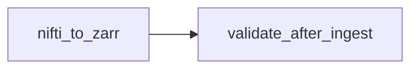
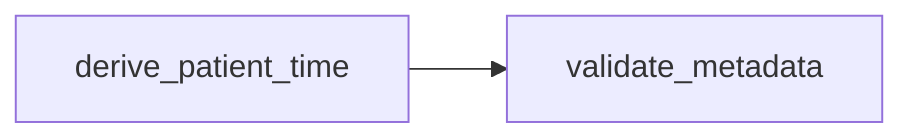
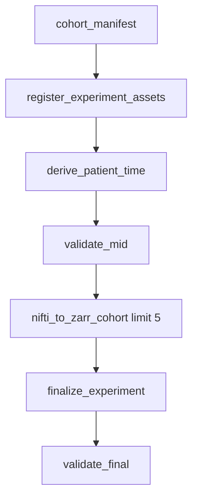

> **Related:** [[Meta/Config Index]] · [[Workflows/Demo Ingestion Workflow]] · [[Workflows/Orchestrating Multimodal Experiments]] · [[Research/Roadmap]] · [[Home]]

# Workflow Index

Three bundled workflow YAML files chain **Tolkien** platform steps with **genfeat_mri** application steps. Config paths: [[Meta/Config Index]].

## Comparison

| Workflow | Steps | Primary outputs | When to use |
|----------|-------|-----------------|-------------|
| `nifti_to_subject_zarr` | 2 | Zarr stores, artifacts, lineage, validation logs | NIfTI → Zarr ingest demo |
| `mri_patient_time` | 2 | `patient_events.csv`, `modality_observations.csv` | Build patient-time spine only |
| `mri_baseline_experiment` | 7 | Cohort + Zarr slice + evaluation bundle + primitives | Full reproducible baseline |

## `nifti_to_subject_zarr.yaml`



| Step | Command module |
|------|----------------|
| `nifti_to_zarr` | `genfeat_mri.ingest.nifti_to_subject_zarr` |
| `validate_after_ingest` | `tolkien.validation.validate` (`val_post_zarr_ingest`) |

Deep dive: [[Workflows/Demo Ingestion Workflow]]

## `mri_patient_time.yaml`



| Step | Command module |
|------|----------------|
| `derive_patient_time` | `genfeat_mri.adapters.mri_adapter` |
| `validate_metadata` | `tolkien.validation.validate` (`val_mri_patient_time`) |

Source policy: [`brats2020_mri.yaml`](../../../configs/sources/brats2020_mri.yaml)

## `mri_baseline_experiment.yaml`

Full end-to-end baseline for this repo (cohort limit 5 subjects for Zarr):



| Step id | Module | Key outputs |
|---------|--------|-------------|
| `cohort_manifest` | `tolkien.cohorts.cohort_manifest` | `cohort_mri_baseline_v1.json` |
| `register_experiment_assets` | `genfeat_mri.experiments.register_assets` | `artifacts.csv`, `entities.csv` |
| `derive_patient_time` | `genfeat_mri.adapters.mri_adapter` | `patient_events.csv`, `modality_observations.csv` |
| `validate_mid` | `tolkien.validation.validate` | `val_mri_baseline_mid_*` |
| `nifti_to_zarr_cohort` | `genfeat_mri.ingest.nifti_to_subject_zarr` | 5× Zarr under `volume_zarr/brats2020/` |
| `finalize_experiment` | `genfeat_mri.experiments.mri_baseline_finalize` | evaluation bundle, cohort stats, primitives |
| `validate_final` | `tolkien.validation.validate` | `val_mri_baseline_final_*` |

Frozen plan: [`mri_baseline_v1.yaml`](../../../data/artifacts/configs/experiments/mri_baseline_v1.yaml)

## Run commands

```bash
# Ingest only
tolkien-run-workflow configs/workflows/nifti_to_subject_zarr.yaml --repo-root .

# Patient-time spine
tolkien-run-workflow configs/workflows/mri_patient_time.yaml --repo-root .

# Full baseline
tolkien-run-workflow configs/workflows/mri_baseline_experiment.yaml --repo-root .
```

## Roadmap alignment

| Roadmap phase | Workflow coverage |
|---------------|-------------------|
| Phase 0 Contract freeze | Validation steps in all workflows |
| Phase 1 MRI patient-time spine | `mri_patient_time.yaml` |
| Phase 3 Reproducible runs | Run manifests + lineage in ingest |
| Phase 4 Evaluation bundles | `mri_baseline_experiment.yaml` finalize step |

See [[Research/Roadmap]].

## Orchestration guide

For multimodal experiment patterns beyond these three YAMLs: [[Workflows/Orchestrating Multimodal Experiments]]

---

**Up:** [[Home]]
